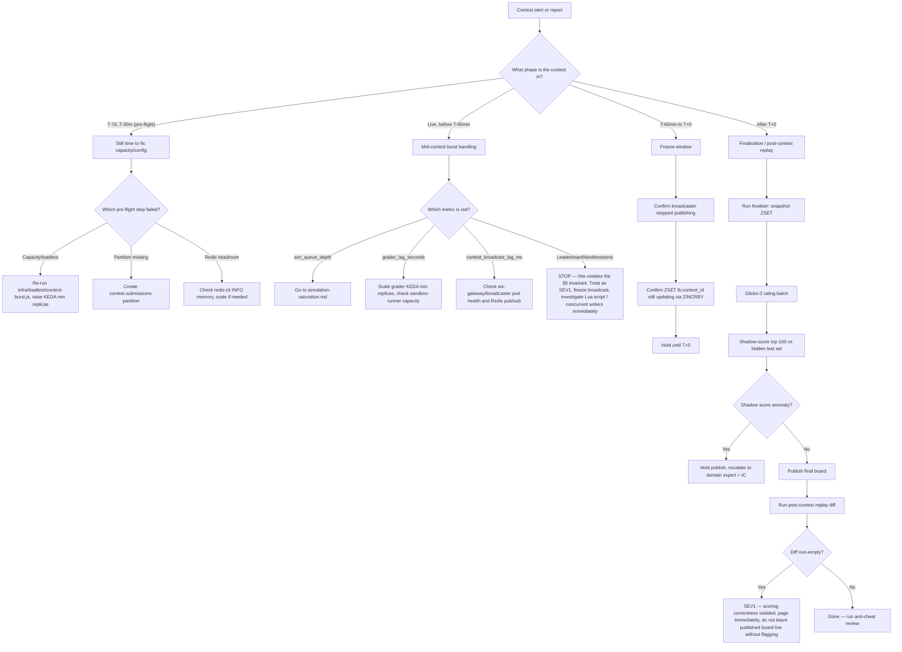

# Contest Day Runbook

Covers §6 (contests: the hardest correctness problem in the product) and the
contest cohort of §1. See also: [oncall.md](oncall.md) for severity/escalation,
[simulation-saturation.md](simulation-saturation.md) for `sim_queue_depth`
response, [postgres-failover.md](postgres-failover.md),
[redis-cluster-incident.md](redis-cluster-incident.md) (leaderboard eviction
is a contest-correctness risk),
[sandbox-escape-suspected.md](sandbox-escape-suspected.md),
[stripe-webhook-backlog.md](stripe-webhook-backlog.md),
[ai-tutor-cost-runaway.md](ai-tutor-cost-runaway.md).

---

## 1. Symptoms

Exact alert names:
- `ContestBroadcastLagHigh` on `contest_broadcast_lag_ms` (§11 domain metric)
- `GraderLagHigh` on `grader_lag_seconds` (§11)
- `SimQueueDepthHigh` on `sim_queue_depth` (§11) — see
  [simulation-saturation.md](simulation-saturation.md)
- `LeaderboardNonMonotonic` — a rank moved backwards for the same underlying
  state, which per §6 should be structurally impossible (score is
  only ever incremented, guarded by `SETNX` inside the same Lua script as the
  `ZINCRBY`); if this fires, something upstream of the invariant broke.
- `ContestSubmitLatencyP99High` — submit path missing its 12ms write budget
  (§6 step 1).

User reports: "my rank went backwards", "leaderboard is frozen/stale" (expected
during the T-60min freeze, see §5 below — distinguish from an unintended
freeze), "my submission has been pending forever", "I got penalized for a
submission I made before the deadline."

Graph shapes: `contest_broadcast_lag_ms` climbing from near-zero toward
seconds; `grader_lag_seconds` climbing as the BullMQ `grade` queue backs up
under contest-priority load; `sim_queue_depth` climbing if problems involve
simulation; submit p99 climbing toward or past the 12ms write budget as
Postgres contention increases; a leaderboard panel showing rank churn that
doesn't correspond to new accepted submissions.

---

## 2. Dashboards to open

Named dashboard: **`journey-join-a-contest`** (§11 — dashboards are per user
journey, not per service). Panels: submit p99, `contest_broadcast_lag_ms`,
`grader_lag_seconds`, `sim_queue_depth`, leaderboard monotonicity check.

Exact PromQL:

```promql
# Submit path p99 latency (budget: 12ms per §6 step 1)
histogram_quantile(0.99, sum(rate(http_request_duration_seconds_bucket{namespace="redquant-prod", route="/contests/:id/submit"}[5m])) by (le))

# Broadcast lag — time between a leaderboard delta being computed and being published to ws:contest:{id}
contest_broadcast_lag_ms{namespace="redquant-prod"}

# Grader lag — how far behind the grade queue is
grader_lag_seconds{namespace="redquant-prod"}

# Sim queue depth (if the contest's problems involve server-side simulation, §4)
sim_queue_depth{namespace="redquant-prod"}

# Leaderboard monotonicity: rate of rank-decrease events (custom counter,
# incremented by the broadcaster or a canary reader whenever a user's
# observed rank decreases between two consecutive snapshots for the same ZSET state)
sum(rate(leaderboard_rank_regression_total{namespace="redquant-prod"}[5m])) by (contest_id)

# BullMQ grade queue depth directly from Redis, contest-priority lane
# redis-cli -c -h <redis-host> LLEN bull:grade:wait
```

---

## 3. Decision tree



Numbered prose:

1. Determine the contest phase: pre-flight (T-7d through T-30m), live before
   the T-60min freeze, in the freeze window (T-60min to T+0), or post-T+0
   finalisation.
2. **Pre-flight**: identify which checklist item is failing (capacity,
   partitioning, Redis headroom, loadtest) and fix it before the contest
   opens — see §4 below. This is the cheapest place to fix anything; treat a
   pre-flight finding as a blocker, not a "monitor it" item.
3. **Live, before freeze**: triage by which domain metric is red.
   `sim_queue_depth` routes to [simulation-saturation.md](simulation-saturation.md).
   `grader_lag_seconds` routes to scaling the `grader` KEDA `ScaledObject` and
   checking `sandbox-runner` capacity. `contest_broadcast_lag_ms` routes to
   checking the broadcaster component and Redis pub/sub health. A
   `LeaderboardNonMonotonic` alert is an invariant violation per §6 — this
   should be structurally impossible given the `SETNX`-guarded `ZINCRBY` Lua
   script, so treat it as SEV1 immediately: freeze broadcast, do not wait for
   the scheduled T-60min freeze, and get the domain expert on the bridge to
   inspect for a concurrent-writer bug or a Lua script version mismatch across
   grader pods.
4. **Freeze window (T-60min)**: confirm the broadcaster has actually stopped
   publishing (public board frozen) while the underlying ZSET keeps updating
   from accepted submissions — see §5.
5. **Post-T+0 finalisation**: run the finaliser (snapshot → Glicko-2 → shadow
   score → publish), then the mandatory post-contest replay. A non-empty
   diff from the replay is automatically SEV1 — halt further publication
   steps and escalate immediately, per §9's zero error budget for contest
   scoring correctness.

---

## 4. Procedures

### 4.1 Pre-flight checklist — T-7d

- [ ] **Capacity review** against §1's contest burst: 4,000 concurrent
  contest participants (8% of the 50k cohort), 44 rps nominal submit rate
  rising to a **~1,300 rps burst** at the deadline. Confirm KEDA
  `ScaledObject`s for `grader` (scales on BullMQ `bull:grade:wait` depth) and
  `quantum-kernel-heavy` (scales on `sim_queue_depth`) have headroom to their
  configured max:
  ```
  kubectl get scaledobject grader -n redquant-prod -o jsonpath='{.spec.maxReplicaCount}'
  kubectl get scaledobject quantum-kernel-heavy -n redquant-prod -o jsonpath='{.spec.maxReplicaCount}'
  ```
- [ ] **Schedule a dry run** of the burst load test against staging:
  ```
  k6 run --vus 1300 --duration 5m \
    -e TARGET=https://staging.redquant.internal \
    -e CONTEST_ID=<staging-canary-contest-id> \
    infra/loadtest/contest-burst.js
  ```
  Confirm submit p99 stays under the 12ms write budget (§6 step 1) and
  `grader_lag_seconds` recovers within a few minutes of the burst ending.

### 4.2 Pre-flight checklist — T-24h

- [ ] **Pre-create the `contest.submissions` monthly partition** if the
  contest falls near a month boundary (partitioned monthly per §5):
  ```
  kubectl exec -n redquant-prod redquant-pg-1 -- psql -U postgres -d redquant -c \
    "SELECT relname FROM pg_class WHERE relname LIKE 'submissions_%' AND relnamespace = 'contest'::regnamespace;"
  ```
  If the target month's partition is missing, create it:
  ```
  kubectl exec -n redquant-prod redquant-pg-1 -- psql -U postgres -d redquant -c \
    "CREATE TABLE contest.submissions_2026_09 PARTITION OF contest.submissions FOR VALUES FROM ('2026-09-01') TO ('2026-10-01');"
  ```
- [ ] **Confirm Redis memory headroom** for `lb:{contest_id}` ZSET growth.
  The contest leaderboard lives in the shared Redis cluster (Postgres is
  regionally shared for cross-cell reads per §2, and the leaderboard is a
  cross-cell/global structure, not cell-local), so check across the cluster's
  shards:
  ```
  for shard in 0 1 2 3 4 5; do
    echo "=== shard-$shard ==="
    kubectl exec -n redquant-prod redis-cluster-$shard -- redis-cli -c INFO memory | grep -E 'used_memory_human|maxmemory_human'
  done
  ```
  See [redis-cluster-incident.md](redis-cluster-incident.md) for what happens
  if memory pressure evicts the leaderboard key — this must not be allowed to
  happen during a contest.

### 4.3 Pre-flight checklist — T-2h

- [ ] **Raise KEDA min replicas** ahead of the deadline burst (steady-state
  is 8 for `grader` per §1 fleet sizing):
  ```
  kubectl patch scaledobject grader -n redquant-prod --type merge \
    -p '{"spec":{"minReplicaCount":20}}'
  kubectl patch scaledobject quantum-kernel-heavy -n redquant-prod --type merge \
    -p '{"spec":{"minReplicaCount":4}}'
  ```
- [ ] **Freeze non-contest deploys** to `api`, `quantum-kernel*`, `grader`,
  and the ws-gateway component of `api` until the contest concludes. This is
  a process control, not a Kubernetes control: no merges to `main` touching
  these paths without explicit on-call + IC sign-off until the contest is
  finalised.

### 4.4 Pre-flight checklist — T-30m

- [ ] Final smoke test against staging or a synthetic canary contest.
- [ ] Confirm `journey-join-a-contest` dashboard is green.
- [ ] Confirm on-call, IC, and the Quantum/Contest domain expert are on the
  bridge before T-0.

### 4.5 What to watch during the contest

| Metric | PromQL | Action threshold |
|---|---|---|
| `contest_broadcast_lag_ms` | `contest_broadcast_lag_ms{namespace="redquant-prod"}` | > 2000ms sustained 1m — investigate broadcaster/pub-sub |
| `grader_lag_seconds` | `grader_lag_seconds{namespace="redquant-prod"}` | > 30s sustained 2m — scale `grader` further, check `sandbox-runner` capacity |
| `sim_queue_depth` | `sim_queue_depth{namespace="redquant-prod"}` | See [simulation-saturation.md](simulation-saturation.md) thresholds |
| Submit p99 | see §2 PromQL | > 12ms budget sustained — check Postgres write contention (see [postgres-failover.md](postgres-failover.md) for pooler saturation checks) |
| Leaderboard monotonicity | `leaderboard_rank_regression_total` | any non-zero rate — SEV1, stop and investigate immediately |

### 4.6 Freeze procedure at T-60min

At T-60min the public board must freeze: the broadcaster stops publishing,
while the Redis ZSET (`lb:{contest_id}`) keeps updating from accepted
submissions (§6).

```
kubectl patch configmap ws-gateway-config -n redquant-prod --type merge \
  -p '{"data":{"CONTEST_BROADCAST_FROZEN":"true"}}'
kubectl rollout restart deployment/api -n redquant-prod
```

Verify the freeze engaged correctly — `contest_broadcast_lag_ms` should
flatline (no new publishes) while the underlying ZSET continues to change:
```
watch -n5 'kubectl exec -n redquant-prod redis-cluster-0 -- redis-cli -c ZCARD lb:<contest_id>'
```
`ZCARD` (member count) and individual `ZSCORE` values should keep changing as
accepted submissions land, even though nothing new reaches
`ws:contest:{id}`.

### 4.7 Finalisation at T+0

1. **Snapshot the ZSET** into `contest.standings_snapshots`:
   ```
   kubectl create job --from=cronjob/contest-finaliser \
     contest-finaliser-<contest_id>-$(date +%s) -n redquant-prod
   ```
2. **Glicko-2 rating batch** — 350 initial deviation, per-contest volatility
   cap (§6), computed as one batch job (triggered by the same finaliser job
   above, or a follow-on job if rating computation is a separate step):
   ```
   kubectl logs -n redquant-prod job/contest-finaliser-<contest_id>-<ts> -f
   ```
   Watch for the rating-batch completion log line before proceeding.
3. **Shadow-score the top 100** against the extended hidden test set before
   ratings publish (§6 anti-cheat):
   ```
   kubectl exec -n redquant-prod deploy/grader -- python -m redquant.contest.shadow_score \
     --contest-id <contest_id> --top-n 100
   ```
   If shadow-scoring flags a discrepancy (a top-100 submission scores
   differently against the extended hidden test set than it did against the
   public test set — a possible sign of test-set-specific overfitting or
   cheating), **hold publish**. Do not proceed to step 4. Escalate to the
   domain expert and IC; the flagged submission(s) need manual review before
   ratings go out.
4. **Publish** the final board (only after shadow-scoring clears):
   ```
   kubectl exec -n redquant-prod deploy/grader -- python -m redquant.contest.publish \
     --contest-id <contest_id>
   ```

### 4.8 Post-contest replay — verifying 100% scoring correctness

Recompute standings independently from the submission log and diff against
the published snapshot:
```
kubectl exec -n redquant-prod deploy/grader -- python -m redquant.contest.replay \
  --contest-id <contest_id> --diff-against-snapshot
```

**If the diff is non-empty, this is a SEV1** per §9 — contest scoring
correctness is a 100% SLO with zero error budget. Do this immediately:
1. Declare SEV1 in the incident channel using the template in
   [oncall.md](oncall.md).
2. Page the domain expert and IC — do not attempt to silently re-publish a
   corrected board without IC sign-off.
3. Do **not** re-run finalisation again until the discrepancy's root cause is
   understood — the most likely causes are a Redis eviction of `lb:{contest_id}`
   during the contest (see
   [redis-cluster-incident.md](redis-cluster-incident.md)), a grader worker
   running a stale Lua script version, or a race in the shadow-scoring step
   that didn't hold publish when it should have.
4. Preserve both the original snapshot and the replay diff output as
   evidence for the retro.

### 4.9 Anti-cheat review

- **Exact-duplicate detection**: query for normalised-AST-hash collisions
  across distinct users in `contest.submissions` for this contest:
  ```
  kubectl exec -n redquant-prod redquant-pg-1 -- psql -U postgres -d redquant -c \
    "SELECT ast_hash, array_agg(DISTINCT user_id), count(*) FROM contest.submissions
     WHERE contest_id = '<contest_id>' GROUP BY ast_hash HAVING count(DISTINCT user_id) > 1;"
  ```
- **Timing analysis**: flag submissions within 4 seconds of problem open
  (§6):
  ```
  kubectl exec -n redquant-prod redquant-pg-1 -- psql -U postgres -d redquant -c \
    "SELECT s.id, s.user_id, s.problem_id, s.submitted_at, p.opened_at
     FROM contest.submissions s JOIN contest.problems p ON p.id = s.problem_id
     WHERE s.contest_id = '<contest_id>' AND s.submitted_at - p.opened_at < interval '4 seconds';"
  ```
- **IP/device clustering**: correlate `contest.submissions` with auth/session
  logs to find clusters of accounts submitting from the same IP/device
  fingerprint in a pattern inconsistent with normal usage (shared classroom
  IPs are expected and not inherently suspicious — look for identical
  device fingerprints across accounts that shouldn't share one, not just
  shared IPs).
- **Manual review queue**: any account flagged by the above, or by
  shadow-scoring anomalies in §4.7 step 3, goes into a manual review queue
  before ratings are considered final. Do not silently disqualify — document
  the finding and route to the domain expert / product trust & safety owner.

---

## 5. Verification

- `contest_broadcast_lag_ms` back to near-zero baseline after unfreezing (or
  correctly flatlined during the freeze window).
- `grader_lag_seconds` and `sim_queue_depth` recovered to steady-state.
- Post-contest replay diff is **empty**.
- Shadow-scoring cleared with no unresolved flags before publish.
- `contest.standings_snapshots` row exists and matches the published board
  shown to users.

## 6. Rollback / if this makes it worse

- If raising KEDA min replicas early (T-2h) causes unrelated resource
  contention with other tiers sharing the node pool, scale back
  `minReplicaCount` toward steady-state and rely on KEDA's normal scale-up
  reacting to the real burst instead of pre-provisioning.
- If the freeze procedure's configmap flip doesn't actually stop the
  broadcaster (verify via §4.6's watch command — if `contest_broadcast_lag_ms`
  is still updating), the rollout restart may not have picked up the new
  config; force a fresh rollout: `kubectl rollout restart deployment/api -n
  redquant-prod` and confirm pod generation changed with `kubectl get pods -n
  redquant-prod -l app.kubernetes.io/name=api -o
  jsonpath='{.items[*].metadata.creationTimestamp}'`.
- If finalisation was run but shadow-scoring should have held it and didn't
  (a bug in the shadow-scoring gate itself), **do not** unpublish
  automatically — that itself risks a second correctness incident. Freeze
  further changes, get IC + domain expert involved, and decide the correction
  path deliberately (typically: publish a corrected snapshot with a clear
  changelog entry, not a silent overwrite).
- If a post-contest replay diff is non-empty and the fix requires rebuilding
  `lb:{contest_id}` from the submission log, follow the leaderboard-rebuild
  procedure in [redis-cluster-incident.md](redis-cluster-incident.md) rather
  than hand-editing ZSET scores.

## 7. Comms

- Internal: use the SEV1/SEV2/SEV3 templates from
  [oncall.md](oncall.md) depending on severity determined above.
- Customer-facing during freeze window: this is expected behavior, not an
  incident — no status-page post needed for a normal T-60min freeze. If
  users report confusion, a proactive in-product banner ("Leaderboard is
  frozen for the final hour — final standings will be published after the
  contest ends") is the product's job, not an incident comms job.
- Customer-facing for a non-empty replay diff (SEV1): do **not** post
  publicly until IC + domain expert confirm what happened and whether any
  user-visible rank/rating actually changed. Use the SEV1 status-page
  template from [oncall.md](oncall.md), worded around "we identified a
  discrepancy in contest results and are correcting it" once the correction
  path is decided.

## 8. Post-incident

Capture, regardless of whether an incident was declared:
- Actual peak submit rps observed vs the ~1,300 rps §1 planning number.
- Whether `grader`/`quantum-kernel-heavy` KEDA scaling kept pace or required
  manual `minReplicaCount` intervention mid-contest.
- Post-contest replay result (empty/non-empty) and, if non-empty, full root
  cause and the fix applied.
- Anti-cheat findings and their disposition (cleared / disqualified /
  escalated to trust & safety).
- Any pre-flight checklist item that was skipped or caught late — feed back
  into tightening the T-7d/T-24h/T-2h/T-30m checklist for the next contest.
