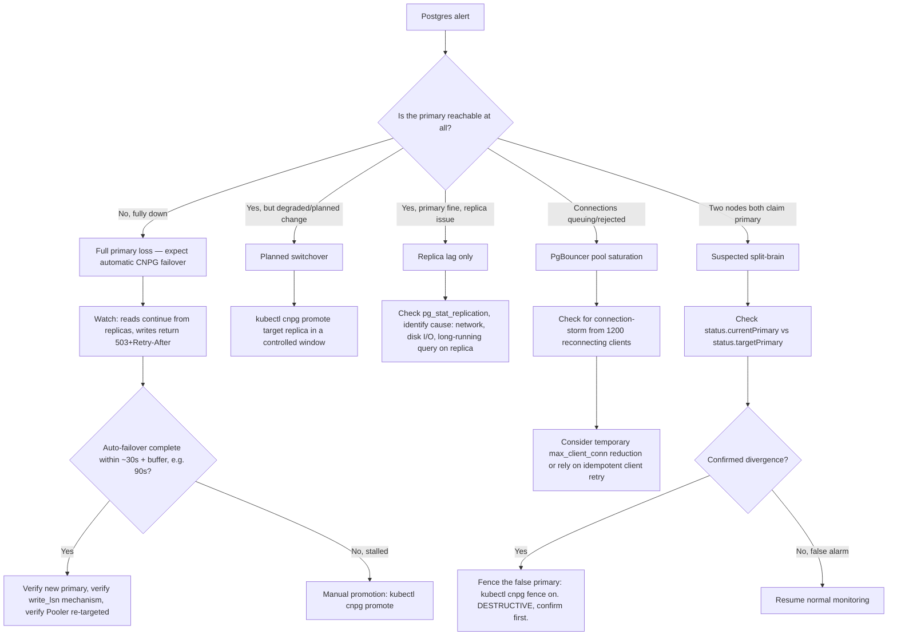

# Postgres Failover Runbook (CloudNativePG)

Covers §5 (data model and storage) and §9 step 6 (Postgres primary failover)
of system-design.md. See also: [oncall.md](oncall.md) for severity/escalation,
[redis-cluster-incident.md](redis-cluster-incident.md),
[simulation-saturation.md](simulation-saturation.md),
[contest-day.md](contest-day.md),
[sandbox-escape-suspected.md](sandbox-escape-suspected.md),
[stripe-webhook-backlog.md](stripe-webhook-backlog.md),
[ai-tutor-cost-runaway.md](ai-tutor-cost-runaway.md).

Postgres is a **regionally shared** resource, not cell-local (§2) — global
leaderboards and cross-cell reads require a single logical database. Every
command in this runbook targets namespace `redquant-prod` only; there is no
per-cell loop needed here.

Infra: CloudNativePG `Cluster` named `redquant-pg` (1 primary + 3 replicas).
CNPG `Pooler`s `redquant-pg-rw` (writes) and `redquant-pg-ro` (reads),
PgBouncer, transaction pooling, 1,200 client conns → 120 server conns (§5).

---

## 1. Symptoms

Exact alert names:
- `PostgresPrimaryDown`
- `PostgresReplicationLagHigh`
- `PgBouncerPoolSaturated`
- `WriteLatencyP99High`
- Multi-window multi-burn-rate alerts on the read-availability SLO (§9,
  99.95% over 28 days)

User reports: "can't save my code", "getting a 503 on submit". Graph shapes:
write error rate spiking to near-100% momentarily, replica lag spiking on
one or more replicas, PgBouncer active-connection count spiking as clients
queue behind the 120-server-connection ceiling.

---

## 2. Dashboards to open

Named dashboards: CNPG-specific Grafana panels (primary/replica role status,
replication lag, WAL lag), plus `journey-run-a-lab` and
`journey-join-a-contest` (§11 — write-heavy paths, dashboards are per-journey
not per-service) for downstream write-path impact, plus the PgBouncer pool
utilization panel.

Exact PromQL:

```promql
# Instance up/down by role
up{namespace="redquant-prod", job="redquant-pg"}

# Replication lag per replica
cnpg_pg_replication_lag_seconds{namespace="redquant-prod"}

# PgBouncer server-connection pool utilization (1200 client -> 120 server, §5)
pgbouncer_pools_server_active_connections{namespace="redquant-prod"}
  / pgbouncer_pools_server_max_connections{namespace="redquant-prod"}

# Write-path 503 rate
sum(rate(http_requests_total{namespace="redquant-prod", job="api", code="503"}[5m]))
```

---

## 3. Decision tree



Numbered prose:

1. Determine which scenario applies: full primary loss (expect CNPG's
   automatic failover), a planned switchover, replica lag only, PgBouncer
   pool saturation, or suspected split-brain.
2. For full primary loss, the ~30s failover window (§9 step 6) is
   **automatic** — CNPG's own leader election promotes a healthy replica.
   Your job during this window is mostly to watch and confirm, not
   intervene, unless auto-failover stalls well beyond the expected window.
3. For a planned switchover, use the same promotion command but as a
   deliberate, controlled action with the old primary demoted cleanly.
4. For replica lag alone (primary healthy), investigate cause before taking
   any promotion action — a lagging replica is not itself an emergency
   unless it threatens the read-availability SLO broadly.
5. For pool saturation, distinguish "normal contest/burst traffic" from "a
   reconnect storm following a failover" — the mitigation differs.
6. For suspected split-brain, verify before acting — CNPG's own fencing
   should prevent this, so treat a suspected occurrence as high-severity and
   confirm carefully before taking the destructive fencing action.

---

## 4. Procedures

### 4.1 Detecting primary loss

```
kubectl cnpg status redquant-pg -n redquant-prod
```
or the underlying resource directly:
```
kubectl get cluster redquant-pg -n redquant-prod -o yaml
```
A healthy cluster shows one instance with role `primary` and three with role
`replica`, all in `streaming` state with low lag. An unhealthy cluster shows
the primary instance missing, in `CrashLoopBackOff`, or the `Cluster`
resource's `.status.phase` reporting a failover in progress
(`"Failing over"` or similar).

### 4.2 The ~30s failover window (§9 step 6)

This is automatic. Once CNPG's health checks detect the primary is
unreachable, it promotes the healthiest replica (lowest replication lag)
without operator intervention. During this window:
- **Reads continue** from the remaining replicas via `redquant-pg-ro`.
- **Writes return `503` with `Retry-After`.**
- **Clients retry idempotently** using a client-generated `Idempotency-Key`
  (§9) — this is why the write path recovering cleanly matters more than
  avoiding the 503s themselves; the 503s are expected and by design.

Watch `kubectl cnpg status redquant-pg -n redquant-prod` continuously during
this window. Do not intervene with a manual promotion unless the window
clearly exceeds ~90 seconds (30s expected + buffer) with no sign of a new
primary being elected.

### 4.3 Promotion / switchover vs failover

- **Failover** (unplanned): CNPG detects primary loss and promotes
  automatically via its own leader election. No manual command needed under
  normal operation.
- **Switchover** (planned): a controlled, operator-initiated promotion of a
  healthy replica, with the old primary demoted cleanly rather than lost.
  Use this for planned maintenance or to move the primary role off a node
  you need to drain:
  ```
  kubectl cnpg promote redquant-pg <replica-pod-name> -n redquant-prod
  ```
- **Manual failover** (auto-failover stalled): the same promote command,
  used only if automatic failover has not completed within ~90 seconds:
  ```
  kubectl cnpg promote redquant-pg <replica-pod-name> -n redquant-prod
  ```
  Pick the replica with the lowest replication lag from the check in §4.4
  below.

### 4.4 Replica lag checks

```
kubectl cnpg status redquant-pg -n redquant-prod
```
shows per-replica lag in its summary table. For raw detail:
```
kubectl exec -n redquant-prod redquant-pg-2 -- psql -U postgres -c \
  "SELECT client_addr, state, sent_lsn, replay_lsn, replay_lag FROM pg_stat_replication;"
```

### 4.5 PgBouncer pool behavior during failover

Transaction pooling means any in-flight transaction on the old primary at
the moment of failure is aborted — this is expected and is exactly why
clients need idempotent retry (§9). The 1,200 client → 120 server connection
ratio (§5) means the `redquant-pg-rw` Pooler itself must reconnect its 120
server-side connections to the new primary; CNPG updates the Pooler's
backend service automatically when the primary role moves.

Check Pooler status:
```
kubectl get pooler redquant-pg-rw -n redquant-prod -o yaml
```

If the Pooler does not automatically re-target the new primary within ~60
seconds of failover completing (it should — this points to a Pooler-side
issue, not a normal part of failover), restart it:
```
kubectl rollout restart deployment/redquant-pg-rw-pooler -n redquant-prod
```

### 4.6 Verifying the write_lsn read-your-own-writes mechanism recovered (§5)

Per §5, reads are served from replicas except reads inside a write
transaction and reads within 500ms of a user's own write, tracked by a
per-user `write_lsn` in Redis. A promoted replica starts a **new timeline**
in Postgres — LSNs are per-timeline, so a `write_lsn` cached from before the
failover could in principle reference the old timeline and produce an
incorrect "have I caught up" comparison against the new primary's LSN
numbering.

Verify:
1. Perform a test write immediately followed by a read as the same user, and
   confirm the read reflects the write (no stale-read regression).
2. Check for a spike in a stale-read-detection metric if one exists:
   ```promql
   sum(rate(write_lsn_check_fallback_total{namespace="redquant-prod"}[5m]))
   ```
   If this metric doesn't exist in your deployment, fall back to the manual
   spot-check in step 1 and consider this a gap worth closing in
   post-incident follow-up.

### 4.7 Backup / PITR restore procedure

Trigger an on-demand backup before any risky corrective action:
```
kubectl cnpg backup redquant-pg -n redquant-prod
```

**⚠️ DESTRUCTIVE — requires explicit second-person confirmation before
proceeding.** Point-in-time recovery creates a **new** `Cluster` resource
bootstrapped from backup + WAL replay to a target time; any cutover to it is
a major action affecting the entire regionally-shared database, not a single
cell.

```yaml
apiVersion: postgresql.cnpg.io/v1
kind: Cluster
metadata:
  name: redquant-pg-restored
  namespace: redquant-prod
spec:
  instances: 4
  bootstrap:
    recovery:
      source: redquant-pg
      recoveryTarget:
        targetTime: "2026-08-29T03:00:00Z"
  externalClusters:
    - name: redquant-pg
      barmanObjectStore:
        destinationPath: <configured-backup-location>
```
Apply only after a second engineer has confirmed the target time and the
intent to restore:
```
kubectl apply -f redquant-pg-restored.yaml
```
Do not cut application traffic over to the restored cluster until DBRE has
validated data integrity against the target recovery time.

### 4.8 Split-brain checks

CNPG's own fencing should prevent two primaries from both accepting writes,
but verify rather than assume:
```
kubectl get cluster redquant-pg -n redquant-prod -o jsonpath='{.status.currentPrimary}'
kubectl get cluster redquant-pg -n redquant-prod -o jsonpath='{.status.targetPrimary}'
```
These should agree. Also check for divergent `pg_stat_replication` output on
both former-primary candidates, and watch for the application-level symptom
of split-brain: duplicate or conflicting writes for the same key that
shouldn't both have succeeded.

**⚠️ DESTRUCTIVE — requires explicit second-person confirmation.** If
split-brain is confirmed, fence the false primary to stop it accepting
further writes:
```
kubectl cnpg fence on <pod-name> -n redquant-prod
```

### 4.9 Connection-storm mitigation

If the reconnect storm from up to 1,200 clients overwhelms the new primary
before PgBouncer settles, options in order of preference:
1. Do nothing extra — clients already retry idempotently (§9), and PgBouncer
   is designed to absorb exactly this pattern via transaction pooling.
2. If genuinely overwhelming, temporarily lower the Pooler's
   `max_client_conn` to shed load gracefully rather than let the primary
   itself buckle:
   ```
   kubectl get pooler redquant-pg-rw -n redquant-prod -o yaml
   # edit .spec.pgbouncer.parameters.max_client_conn downward, then apply
   ```
3. As a last resort, rate-limit new connections at the ingress layer if the
   storm is severe and sustained.

---

## 5. Verification

- `kubectl cnpg status redquant-pg -n redquant-prod` shows exactly one
  primary and all replicas in `streaming` state with low lag.
- Write error rate back to baseline.
- `write_lsn` mechanism confirmed sane per §4.6.
- PgBouncer pool utilization back to normal levels.

## 6. Rollback / if this makes it worse

- If a manual promotion turns out to have been the wrong call (e.g. the
  "lost" primary was actually a transient network partition, not a real
  failure), you may now have two nodes with primary history — check for
  split-brain per §4.8 immediately and fence the incorrect one if confirmed.
- If a PITR restore was pointed at the wrong target time, **do not cut over**
  — delete the restored `Cluster` resource before it's ever used for traffic
  and re-run with the corrected target:
  ```
  kubectl delete cluster redquant-pg-restored -n redquant-prod
  ```
  (confirm with a second engineer before deleting, same as the original
  restore action).

## 7. Comms

Use the SEV1/SEV2 templates from [oncall.md](oncall.md). Since writes
return 503+Retry-After by design during the failover window, be precise in
customer comms: "brief write delays, all data safe" rather than implying
data loss, unless data loss is actually confirmed.

## 8. Post-incident

Capture:
- Actual failover duration vs the ~30s §9 budget — did it beat or miss the
  SLO window?
- Whether client-side `Idempotency-Key` retries worked cleanly (check for
  any duplicate-write reports, which would indicate a client or gateway
  idempotency bug, not a Postgres problem).
- Whether the `write_lsn` mechanism showed any stale-read symptoms.
- Any replica that lagged meaningfully before or during the incident — worth
  independent follow-up regardless of whether it was the promoted replica.
