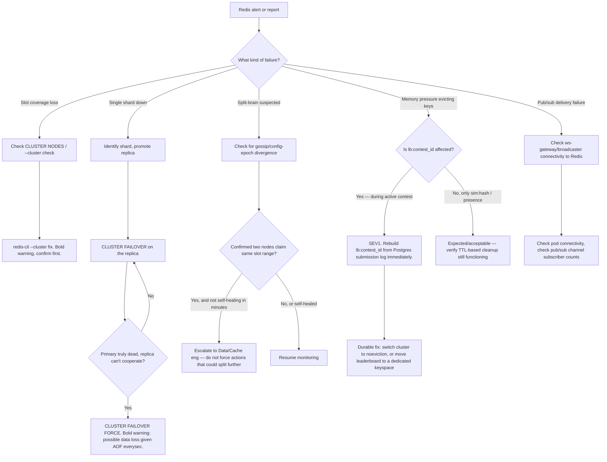

# Redis Cluster Incident Runbook

Covers §5 (Redis usage) of system-design.md. See also:
[oncall.md](oncall.md) for severity/escalation,
[contest-day.md](contest-day.md) (leaderboard eviction is a
contest-correctness risk, cross-linked both ways),
[postgres-failover.md](postgres-failover.md),
[simulation-saturation.md](simulation-saturation.md),
[sandbox-escape-suspected.md](sandbox-escape-suspected.md),
[stripe-webhook-backlog.md](stripe-webhook-backlog.md),
[ai-tutor-cost-runaway.md](ai-tutor-cost-runaway.md).

Infra: `StatefulSet` `redis-cluster`, 12 pods = 6 shards × 1 replica,
`cluster-enabled`, AZ-aware, AOF `everysec` durability (§5). Namespace
`redquant-prod`.

## Key namespaces and what breaks (§5)

| Key pattern | Purpose | What breaks if evicted/lost |
|---|---|---|
| `lb:{contest_id}` | Leaderboard ZSET, score = `(points<<32) \| (2^32 - penalty_seconds)` | **Contest-correctness risk. MUST NOT be evicted.** Losing this loses the whole leaderboard for that contest, not just staleness — `ZINCRBY` is the only writer and there is no other live copy. |
| `sim:{hash}` | Simulation cache, 24h TTL (§4) | Safe to evict — cache miss just means recomputation, no correctness impact, only a latency/cost cost. |
| `rl:{bucket}` | Rate-limit token buckets (§9) | Likely fails **open** on eviction — see §5.6 below. Minor abuse-surface risk, not a correctness risk. |
| `sess:{sid}` | Sessions, 14d TTL sliding | Forced logout. UX blast radius only, no data loss. |
| `presence:{lesson_id}` | HyperLogLog of concurrent viewers | Low value, safe to lose. |
| `ws:contest:{id}`, `ws:user:{id}` pub/sub | Real-time fanout channels | Not persisted data, but active delivery matters — a pub/sub outage breaks real-time updates even if the underlying ZSET is intact. |

---

## 1. Symptoms

Exact alert names:
- `RedisClusterSlotCoverageLoss`
- `RedisShardDown`
- `RedisMemoryPressureHigh`
- `LeaderboardKeyEvicted` — a keyspace-notification-driven alert specifically
  watching for eviction events on `lb:*` keys, given the correctness risk
- `SimCacheHitRatioLow` — cross-reference
  [simulation-saturation.md](simulation-saturation.md)

User reports: "I got logged out" (`sess:{sid}` loss), "leaderboard shows
wrong rank / my score disappeared" (`lb:{contest_id}` eviction — treat as
SEV1 if a contest is active), "rate limit not being enforced, I'm getting
limited when I shouldn't be" (rate-limit bucket inconsistency).

---

## 2. Dashboards to open

Named dashboard: `journey-join-a-contest` for leaderboard impact, plus a
Redis-cluster infra dashboard (slot coverage map, per-shard memory, per-shard
ops/s, eviction counter).

Exact PromQL / checks:

```promql
# Cluster slot coverage — should be 0 always
redis_cluster_slots_fail{namespace="redquant-prod"}

# Per-shard memory pressure
redis_memory_used_bytes{namespace="redquant-prod"} / redis_memory_max_bytes{namespace="redquant-prod"}

# Eviction rate (cluster-wide, not broken down by key pattern by default)
sum(rate(redis_evicted_keys_total{namespace="redquant-prod"}[5m]))
```

Standard Redis metrics don't break evictions down by key pattern. To check
whether `lb:*` keys specifically are being evicted, you need one of:
- **Keyspace notifications**: `CONFIG SET notify-keyspace-events Ex` and
  subscribe to `__keyevent@0__:expired` / eviction events, filtering for the
  `lb:` prefix.
- **Periodic `SCAN` sampling**: compare a recent snapshot of `lb:*` key names
  against a current one and look for disappearances correlated with an
  eviction-rate spike.
- A custom exporter, if one exists in your deployment, that labels eviction
  metrics by key-pattern prefix.

Be honest with yourself here: without one of the above already wired up,
you are inferring eviction of protected keys indirectly (via `ZCARD`/`EXISTS`
checks in §5.5 below), not observing it directly. This is a real
observability gap — flag it as a post-incident follow-up if it slows you
down.

---

## 3. Decision tree



Numbered prose:

1. Classify the failure: slot coverage loss, single shard down, suspected
   split-brain, memory-pressure eviction, or pub/sub delivery failure.
2. For slot coverage loss, check cluster health with `--cluster check` and
   repair carefully with `--cluster fix` (destructive — see §4.1).
3. For a single shard down, identify it via `CLUSTER NODES` and manually
   failover its replica if automatic failover hasn't already happened.
4. For suspected split-brain, verify before acting — it should self-heal via
   Redis Cluster's own config-epoch conflict resolution once any network
   partition clears; escalate rather than force further actions if it
   doesn't resolve within a few minutes.
5. For memory-pressure eviction, the critical branch is **whether
   `lb:{contest_id}` is affected**. If yes, and a contest is active, this is
   SEV1 — go straight to the rebuild procedure in §4.5, then to the durable
   fix.
6. For pub/sub delivery failure, check connectivity between the
   ws-gateway/broadcaster component and the Redis cluster, and subscriber
   counts on the relevant channels.

---

## 4. Procedures

### 4.1 Slot coverage loss

Check cluster health:
```
kubectl exec -n redquant-prod redis-cluster-0 -- redis-cli -c --cluster check \
  redis-cluster-0.redis-cluster.redquant-prod.svc.cluster.local:6379
```

**⚠️ Requires care and second-person confirmation.** `--cluster fix` can
reassign slots and, in edge cases, lose keys during the repair — do not run
it solo under time pressure without a second engineer confirming the plan:
```
kubectl exec -n redquant-prod redis-cluster-0 -- redis-cli -c --cluster fix \
  redis-cluster-0.redis-cluster.redquant-prod.svc.cluster.local:6379
```

### 4.2 Failed shard

Identify the failed node:
```
kubectl get pods -n redquant-prod -l app.kubernetes.io/name=redis-cluster
kubectl exec -n redquant-prod redis-cluster-0 -- redis-cli -c CLUSTER NODES
```
Look for a node marked `fail` or `fail?` in the `CLUSTER NODES` output.

Manual failover promotion of that shard's replica:
```
kubectl exec -n redquant-prod redis-cluster-<replica-index> -- redis-cli -h <replica-host> -p 6379 CLUSTER FAILOVER
```

**⚠️ `FORCE` variant — bold warning.** Only if the primary is truly dead and
cannot cooperate with a graceful handoff. Because replication is AOF
`everysec` (not synchronous), forcing a failover can cause brief data loss
for writes that hadn't yet replicated:
```
kubectl exec -n redquant-prod redis-cluster-<replica-index> -- redis-cli -h <replica-host> -p 6379 CLUSTER FAILOVER FORCE
```

### 4.3 Split-brain

Occurs, if at all, from a network partition between AZs before the
cluster-bus failure-detection timeout triggers a clean failover. Detect via
disagreement in `CLUSTER NODES` output between the two partitioned halves,
or two nodes both claiming ownership of the same slot range.

Resolution: Redis Cluster's own gossip protocol and config-epoch conflict
resolution should self-heal this once the partition clears. Only intervene
manually if it does **not** self-heal within a few minutes — and when you
do, escalate to Data/Cache eng rather than forcing further failover/fix
actions that could split the data further.

### 4.4 AOF everysec durability implications

`everysec` fsync means up to one second of writes can be lost on an unclean
shard restart or crash. This matters most for `lb:{contest_id}` during an
active contest: a lost `ZINCRBY` could under-count a submission that
Postgres's `contest.submissions`/`submission_results` tables have already
durably recorded, since Redis is not the source of truth for the submission
itself — only for the aggregate score. This is exactly what
[contest-day.md](contest-day.md)'s **post-contest replay** exists to catch
and correct: it recomputes standings from the submission log (source of
truth) and diffs against the published snapshot.

### 4.5 maxmemory-policy `allkeys-lru` evicting the leaderboard — the core scenario

`allkeys-lru` evicts across the **entire keyspace** by recency, with no
awareness of key pattern. Under memory pressure it can and will evict
`lb:{contest_id}` keys exactly like any `sim:{hash}` key — but losing a
leaderboard key is catastrophic (whole-leaderboard loss for that contest),
while losing a `sim:{hash}` key is a cache miss.

**Detection**: correlate an eviction-rate spike with a drop in
`lb:{contest_id}` member count or the leaderboard reading empty/short:
```
kubectl exec -n redquant-prod redis-cluster-0 -- redis-cli -c ZCARD lb:<contest_id>
kubectl exec -n redquant-prod redis-cluster-0 -- redis-cli -c EXISTS lb:<contest_id>
```
Compare before/after an eviction spike. A sudden drop in `ZCARD` or `EXISTS`
returning `0` for a leaderboard you know should exist is confirmation.

**If confirmed during an active contest, this is SEV1.** Restore from the
source of truth — Postgres — rather than attempting to guess at lost
scores:
```
kubectl exec -n redquant-prod deploy/grader -- python -m redquant.contest.replay \
  --contest-id <contest_id> --rebuild-leaderboard
```
This replays accepted submissions from `contest.submissions`/
`submission_results` through the same `SETNX`-guarded `ZINCRBY` Lua script
logic used in normal operation (§6), rebuilding `lb:{contest_id}` from
scratch. This is the same replay mechanism [contest-day.md](contest-day.md)
uses for the mandatory post-contest correctness check, applied here as a
live rebuild mid-contest.

**The durable fix** (not just incident response — track as a follow-up if
not already implemented): Redis Cluster does not support per-key
maxmemory-policy, so the real fix is one of:
- (a) Move the leaderboard to a separate Redis deployment/shard-group with
  `noeviction` and memory sized generously for expected ZSET growth, or
- (b) Set the shared cluster's policy cluster-wide to `noeviction` and rely
  on `sim:{hash}`'s 24h TTL (§4) for cache cleanup instead of LRU eviction.

Check current policy:
```
kubectl exec -n redquant-prod redis-cluster-0 -- redis-cli -c CONFIG GET maxmemory-policy
```
Mitigate immediately (cluster-wide, loop over all 6 shard primaries):
```
for shard in 0 1 2 3 4 5; do
  kubectl exec -n redquant-prod redis-cluster-$shard -- redis-cli -c CONFIG SET maxmemory-policy noeviction
done
```
**Tradeoff, stated plainly**: `noeviction` means writes start failing with
OOM errors once memory fills, instead of silently evicting protected keys.
This converts a silent correctness bug into a loud availability problem —
per §9's "sheds load without lying to the user" philosophy, this is the
**right** tradeoff, but it requires immediate follow-up to relieve memory
pressure (scale Redis memory, or manually expire cold `sim:*` keys) so you
don't trade a silent-correctness incident for a write-failure incident.

### 4.6 Losing session data (`sess:{sid}`)

Blast radius: forced logout. No correctness risk, no data loss beyond user
convenience. Mitigation: let affected users re-authenticate; not urgent
enough to warrant emergency action on its own.

### 4.7 Rate-limit buckets (`rl:{bucket}`) failing open vs closed

Token-bucket Lua scripts are typically written to initialize-if-absent, so
eviction of an `rl:{bucket}` key most likely fails **open** — the bucket is
recreated fresh on the next request, effectively resetting that bucket's
limit. This is a minor abuse-surface risk (a small window where a user's
limit resets early), not a correctness risk. Verify against the actual
rate-limit Lua script in the `api` codebase if you need certainty — don't
block incident response on confirming this, it's a low-severity side effect
either way.

---

## 5. Verification

- `redis-cli --cluster check` reports clean, full slot coverage.
- `ZCARD lb:{contest_id}` counts match expected order-of-magnitude for
  active contests (compare against known registration/submission counts).
- No ongoing eviction of protected (`lb:*`) keys — confirm via the
  keyspace-notification or SCAN-sampling method in §2.

## 6. Rollback / if this makes it worse

- If `--cluster fix` made coverage worse, escalate to Data/Cache eng
  immediately rather than running further repair commands blind.
- If `CLUSTER FAILOVER FORCE` caused a worse split (e.g. the "dead" primary
  wasn't actually dead and now two nodes have conflicting state), treat as
  split-brain (§4.3) and escalate rather than forcing more actions.
- If switching to `noeviction` causes an immediate write-failure storm
  because memory was already nearly full, temporarily scale Redis memory
  (add cluster capacity) or manually delete cold, clearly-safe `sim:*` keys
  to buy headroom while addressing root cause — do not revert to
  `allkeys-lru` to relieve the pressure, since that reintroduces the
  leaderboard-eviction risk you just fixed.

## 7. Comms

Use the SEV1 template from [oncall.md](oncall.md) if leaderboard data was
affected during an active contest — this is user-visible and
correctness-sensitive, so be direct with affected users once the rebuild is
verified complete.

## 8. Post-incident

Capture:
- Whether `lb:*` eviction actually happened, and whether
  [contest-day.md](contest-day.md)'s post-contest replay would have caught
  it if the live rebuild in §4.5 hadn't already done so.
- Action item to implement the durable fix (separate leaderboard keyspace,
  or cluster-wide `noeviction`) if not already done before the next contest.
- Any AOF-`everysec` data-loss window observed during a shard failure, and
  whether Postgres's source-of-truth tables covered for it cleanly.
