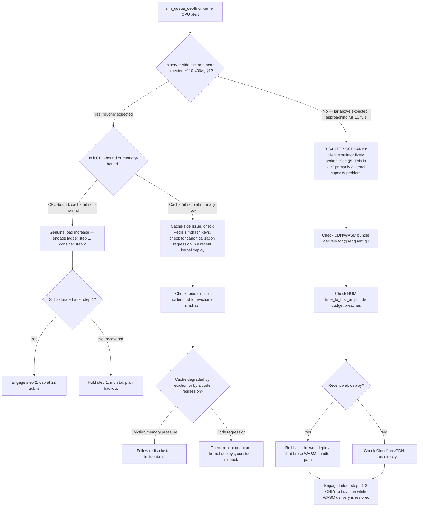

# Simulation Tier Saturation Runbook

Covers §4 (the simulation tier: the single most important design decision)
and §9 (graceful degradation ladder, steps 1-2 in detail). See also:
[oncall.md](oncall.md) for severity/escalation,
[contest-day.md](contest-day.md) (contests watch `sim_queue_depth` and route
here), [postgres-failover.md](postgres-failover.md),
[redis-cluster-incident.md](redis-cluster-incident.md),
[sandbox-escape-suspected.md](sandbox-escape-suspected.md),
[stripe-webhook-backlog.md](stripe-webhook-backlog.md),
[ai-tutor-cost-runaway.md](ai-tutor-cost-runaway.md).

---

## 0. The §4 three-tier context (read this before touching anything)

Simulation traffic is split by qubit count into three tiers. You need this to
understand why the degradation ladder is shaped the way it is, and why the
disaster scenario at the end of this document is a disaster:

| Tier | Where | Range | Latency | Share of traffic |
|---|---|---|---|---|
| **T-A** Client statevector | Browser, TypeScript `@redquant/qir`, shipped as a WASM bundle via CDN | ≤ 14 qubits | < 8ms, no network | **~92%** |
| **T-B** Server statevector | `quantum-kernel`, NumPy, synchronous | 15-30 qubits | 40-900ms | ~7.5% |
| **T-C** Heavy / tensor-network / noisy | `quantum-kernel` async queue, WebSocket streamed | 31-40 qubits, or noisy density-matrix | 1-60s | ~0.5% |

Editing a circuit is T-A: every keystroke re-simulates locally in the
browser, which is why circuit editing feels instant and doesn't touch the
network at all under normal operation. This also means **kernel saturation
should never affect circuit editing** — if it does, you are almost certainly
looking at the disaster scenario in §5, not ordinary server-side saturation.

**§4 memory guard.** A statevector of `n` qubits is `2^n * 16` bytes. At
`n=30` that's 16 GiB. This is why there is a hard admission-control cap and
why plan tiers (§7) cap max qubits per plan (Free 16, Pro 28, Teams 30,
Campus 32). Density-matrix (noisy) simulation is capped at `n=14` (4 GiB) —
noisy simulation needs a full density matrix (`2^(2n)` entries vs `2^n` for a
pure statevector), so its memory cost grows far faster with `n`.

This is also **why step 2 of the ladder caps at 22 qubits**: `2^22 * 16
bytes` = 64 MiB per simulation. Even under concurrent load from many users
simultaneously hitting the cap, per-request memory stays small and
predictable — deliberately conservative relative to the plan-tier ceiling of
32 qubits (Campus, §7), because step 2 exists specifically to buy headroom
during saturation, not to serve the product's normal ceiling.

---

## 1. Symptoms

Exact alert names:
- `SimQueueDepthHigh` on `sim_queue_depth` (§11 domain metric)
- `SimCacheHitRatioLow` on `sim_cache_hit_ratio` (§11)
- `KernelCPUSaturated` — `quantum-kernel` pod CPU pinned near limit
- `TimeToFirstAmplitudeBudgetBreached` — the RUM metric `time_to_first_amplitude`
  (§11), budget 120ms, breaching broadly across users

User reports: "circuit editing feels laggy or frozen" (unusual — see the
disaster scenario if this is widespread, since T-A should be immune to
server load), "simulation stuck at queued" (expected T-B/T-C behavior once
ladder step 1 engages — confirm the UI is showing a queue position, not
silently hanging).

Graph shapes: `sim_queue_depth` climbing steadily or in a step function;
kernel CPU pinned at or near its limit across most/all `quantum-kernel` pods;
`sim_cache_hit_ratio` cratering (a cache-side problem compounding load, not
just raw load); T-B/T-C request volume far exceeding the ~110/s steady /
~400/s peak expected from the ~7.5%+0.5% residual traffic share (§1) — this
last one is the disaster-scenario signature, see §5.

---

## 2. Dashboards to open

Named dashboards: **`journey-run-a-lab`** (primary — server-side simulation
happens here) and **`journey-read-a-lesson`** (carries the
`time_to_first_amplitude` RUM metric, since circuit editing happens inside
lessons; §11 dashboards are per-journey, not per-service).

Panels: `sim_queue_depth`, `sim_cache_hit_ratio`, kernel CPU/queue,
T-A/T-B/T-C traffic split.

Exact PromQL:

```promql
# Queue depth for T-B/T-C requests
sim_queue_depth{namespace="redquant-prod"}

# Cache hit ratio on the sha256(canonical_ir||backend||shots||noise_model||seed) key (§4)
sim_cache_hit_ratio{namespace="redquant-prod"}

# Kernel CPU saturation per pod
sum(rate(container_cpu_usage_seconds_total{namespace="redquant-prod", pod=~"quantum-kernel-.*"}[5m])) by (pod)
  / sum(kube_pod_container_resource_limits{namespace="redquant-prod", resource="cpu", pod=~"quantum-kernel-.*"}) by (pod)

# Server-side sim request rate — compare against expected ~110/s steady, ~400/s peak (§1)
sum(rate(quantum_kernel_sim_requests_total{namespace="redquant-prod"}[5m]))

# Fraction of expected client-side load: if this number approaches the full
# 1,375 sim/s nominal edit rate (§1), the ~92% that should never leave the
# browser is instead hitting the server — this is the disaster scenario in §5
sum(rate(quantum_kernel_sim_requests_total{namespace="redquant-prod"}[5m])) / 1375
```

---

## 3. Decision tree



Numbered prose:

1. Check the server-side sim request rate against the ~110/s steady (~400/s
   peak) expectation from §1. If it is roughly in that range, this is
   ordinary saturation — proceed to step 2. If it is far above that,
   approaching the full 1,375 sim/s nominal edit rate, this is the disaster
   scenario in §5 — go there directly, ladder steps alone will not fix it.
2. For ordinary saturation, distinguish CPU-bound (cache hit ratio normal,
   kernel pods pinned) from cache-degraded (`sim_cache_hit_ratio` abnormally
   low, which compounds load because requests that should have been served
   from cache are recomputing).
3. If cache-degraded, check whether it's an eviction problem (Redis memory
   pressure — see [redis-cluster-incident.md](redis-cluster-incident.md)) or
   a code regression (a recent `quantum-kernel` deploy changed the
   canonicalisation logic, breaking the intentional collision of
   semantically-identical circuits, per §4 — check `kubectl rollout history`
   and consider rollback).
4. For genuine CPU-bound saturation, engage ladder step 1
   (`DEGRADE_SIM_ASYNC`). If still saturated after a few minutes, engage step
   2 (`DEGRADE_SIM_MAX_QUBITS=22`).
5. For the disaster scenario, the ladder steps only buy time — the real fix
   is restoring `@redquant/qir` WASM delivery. Engage steps 1-2 anyway to
   protect the kernel while you fix delivery, but do not consider the
   incident mitigated until server-side sim rate returns to its expected
   ~7.5%+0.5% share.

---

## 4. Procedures — walking the §9 degradation ladder

### Step 1 — `DEGRADE_SIM_ASYNC`

**Trigger**: `sim_queue_depth` sustained above threshold for 2 minutes, or
kernel CPU > 85% sustained for 2 minutes:
```promql
sim_queue_depth{namespace="redquant-prod"} > 200
```
(tune the literal threshold to your observed steady-state baseline plus
margin; 200 is illustrative — check the dashboard's own alert rule for the
currently configured value).

**Engage**:
```
kubectl patch configmap quantum-kernel-config -n redquant-prod --type merge \
  -p '{"data":{"DEGRADE_SIM_ASYNC":"true"}}'
kubectl rollout restart deployment/quantum-kernel -n redquant-prod
```

**User-visible effect**: T-B (server statevector, 15-30 qubits) requests get
`202 + queued` instead of a synchronous response within the 900ms budget; the
UI shows a queue position. Per §9, this "sheds load without lying to the
user" — the user is told their simulation is queued, not given a silent
delay or a fake result.

**Verify engaged**:
```
kubectl get configmap quantum-kernel-config -n redquant-prod -o jsonpath='{.data.DEGRADE_SIM_ASYNC}'
```
Confirm the response shape changed — issue a test T-B request and confirm a
`202` with a queue-position payload rather than a synchronous `200`.

**Exit criteria**: `sim_queue_depth` back under threshold, sustained for 10
minutes. Back out:
```
kubectl patch configmap quantum-kernel-config -n redquant-prod --type merge \
  -p '{"data":{"DEGRADE_SIM_ASYNC":"false"}}'
kubectl rollout restart deployment/quantum-kernel -n redquant-prod
```

### Step 2 — `DEGRADE_SIM_MAX_QUBITS=22`

**Trigger**: step 1 already engaged AND still saturated after several
minutes — queue depth still climbing, or kernel CPU still pinned.

**Engage**:
```
kubectl patch configmap quantum-kernel-config -n redquant-prod --type merge \
  -p '{"data":{"DEGRADE_SIM_MAX_QUBITS":"22"}}'
kubectl rollout restart deployment/quantum-kernel -n redquant-prod
```

**User-visible effect**: server sims restricted to ≤ 22 qubits; the UI states
the temporary cap explicitly (§9 — "sheds load without lying to the user").
See §0 above for why 22 is the chosen number: `2^22 * 16 bytes` = 64 MiB per
simulation, deliberately conservative against the 32-qubit Campus plan
ceiling (§7), keeping per-request memory small and predictable under
concurrent saturation load.

**Verify engaged**: attempt a >22-qubit server-side simulation request and
confirm a graceful, labelled rejection (not a timeout, not an OOM, not a
silent truncation):
```
curl -s -X POST https://api.redquant.internal/v1/simulate \
  -H "Authorization: Bearer <test-token>" \
  -d '{"qubits": 26, "circuit": "<test-circuit-ir>"}' | jq .
```
Expect an explicit `"error": "temporary_qubit_cap"`-shaped response (or
equivalent per the actual API contract), not a 5xx.

**Exit criteria**: kernel CPU and `sim_queue_depth` both nominal for 15
minutes. Back out:
```
kubectl patch configmap quantum-kernel-config -n redquant-prod --type merge \
  -p '{"data":{"DEGRADE_SIM_MAX_QUBITS":""}}'
kubectl rollout restart deployment/quantum-kernel -n redquant-prod
```
Then, once stable, back out step 1 as well following its own exit criteria
above — don't leave both flags engaged longer than necessary once load
recovers.

### Steps 3-6 — for context, owned by other runbooks

The ladder continues past the sim tier:

| Step | Trigger | Effect | Owning runbook |
|---|---|---|---|
| 3 | AI tutor over budget | Falls back to retrieval-only answers with citations (`DEGRADE_TUTOR_RETRIEVAL_ONLY`) | [ai-tutor-cost-runaway.md](ai-tutor-cost-runaway.md) |
| 4 | ClickHouse down | Analytics pages show "delayed" (`DEGRADE_ANALYTICS_DELAYED`), core learning unaffected | (analytics-specific, not covered by a dedicated runbook here) |
| 5 | Stripe down | Entitlements keep working from cached table, purchases queue (`DEGRADE_BILLING_QUEUE`) | [stripe-webhook-backlog.md](stripe-webhook-backlog.md) |
| 6 | Postgres primary failover (~30s) | Reads from replicas, writes 503+Retry-After, idempotent client retry | [postgres-failover.md](postgres-failover.md) |

---

## 5. The disaster scenario: the client-side simulator has failed to load

**This is the real disaster.** Under normal operation, ~92% of all
simulation traffic (T-A, §4) never leaves the browser. If the client-side
simulator (`@redquant/qir`, shipped as a WASM bundle via the CDN per the §2
topology diagram — "static, MDX HTML, images, WASM sim") fails to load for a
broad set of users, that entire 92% share can suddenly fail over to the
server, turning an expected ~110/s steady server-side load into something
approaching the full 1,375 sim/s nominal edit rate — **more than a 10x
capacity multiplier overnight, with no server-side autoscaling policy
designed to absorb it.**

**Detection**:
```promql
sum(rate(quantum_kernel_sim_requests_total{namespace="redquant-prod"}[5m])) / 1375
```
If this ratio is climbing well past ~0.08 (the ~8% expected server-side
share) toward 1.0, client-side simulation is failing broadly.

**Confirmation**:
- Check CDN error rates / 404s on the WASM bundle path. If your CDN exposes
  edge logs or an error-rate dashboard for static assets, filter for the
  `@redquant/qir` bundle path specifically.
- Check the RUM metric `time_to_first_amplitude` (§11, 120ms budget) for a
  broad spike in budget breaches — if the client simulator can't load, users
  never see their circuit's state at all, which will show as either a huge
  latency spike or a distinct error/timeout pattern in RUM.
- Check browser-side error telemetry if available (JS exception rate, WASM
  instantiation failures) for a spike correlated with a recent `web` deploy.

**What to do**: this is **not primarily a kernel-capacity problem**.
Engaging ladder steps 1-2 only buys time by shedding load at the server —
it does not fix the underlying cause and cannot fully absorb a ~12x
unexpected load increase regardless of how aggressively you scale
`quantum-kernel`. The real fix is restoring CDN/WASM asset delivery:
1. Check Cloudflare/CDN status directly for an outage or misconfiguration
   affecting static asset serving.
2. Check the `web` deployment's most recent release for a change to the
   static asset build/publish step that could have broken the WASM bundle
   path (wrong content-type, wrong cache-control causing stale/missing
   assets, a build artifact that didn't get published):
   ```
   kubectl rollout history deployment/web -n redquant-prod
   ```
3. If a recent `web` deploy correlates with the onset, **roll it back**:
   ```
   kubectl rollout undo deployment/web -n redquant-prod
   ```
4. Engage ladder steps 1-2 in parallel to protect `quantum-kernel` while
   delivery is restored — this is damage control, not the fix.
5. Do not consider the incident resolved until the server-side sim rate
   ratio above returns to its expected ~0.08 baseline.

---

## 6. Verification

- Each ladder step, once engaged, is confirmed via the specific verify
  command in §4 (queued-response shape for step 1, graceful qubit-cap
  rejection for step 2).
- T-A (client-side) traffic is confirmed unaffected — sample a circuit-edit
  interaction and confirm it never touches the network (browser devtools
  network tab, or trust the RUM `time_to_first_amplitude` metric staying
  under budget for unaffected users).
- For the disaster scenario, verification means the server-side sim rate
  ratio has returned to baseline, not just that the ladder steps engaged.

## 7. Rollback / if this makes it worse

- If capping at 22 qubits doesn't relieve pressure, re-check whether this is
  actually the disaster scenario in §5 — a genuine capacity problem should
  respond to step 2 within minutes; if it doesn't, you're very likely
  looking at a load-source problem (client-simulator failure), not a
  capacity problem.
- If backing out a flag causes immediate re-saturation, re-engage it and
  hold — do not oscillate. Treat as a sustained incident requiring real
  capacity addition: raise the `quantum-kernel` HPA max above its §1 steady
  ceiling of 120, or add `quantum-kernel-heavy` KEDA capacity for T-C.
- If a `web` rollback (§5) doesn't restore WASM delivery, check the CDN
  layer directly rather than continuing to roll back `web` deploys — the
  fault may be at the CDN/edge, not the origin.

## 8. Comms

Use the SEV2/SEV1 templates from [oncall.md](oncall.md). For the disaster
scenario, be explicit in customer comms that circuit editing may be slow or
temporarily capped while client-side simulation is restored — per §9's
"sheds load without lying to the user," do not describe this as a generic
"performance issue" if you know the actual cause is a broken client asset.

## 9. Post-incident

Capture:
- Whether root cause was genuine load, cache degradation, or the disaster
  scenario.
- If the disaster scenario: which deploy or CDN event broke WASM delivery,
  and what CI/CD or CDN-monitoring gap allowed it to ship or go undetected.
- Whether ladder steps 1-2 engaged automatically or required manual
  intervention — feed back into tuning the automatic trigger thresholds if
  manual intervention was needed.
- Follow-up: consider adding a synthetic canary that continuously exercises
  T-A client-side simulation from a real browser context and alerts
  directly on WASM load failure, rather than relying solely on the
  server-side rate ratio as an indirect signal.
