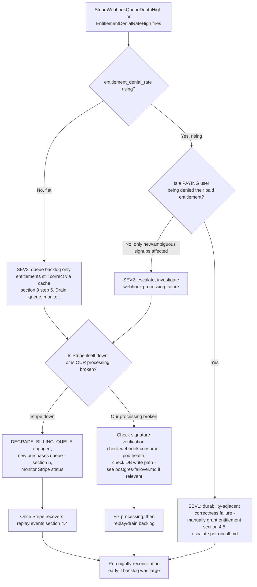

# Stripe webhook backlog

Covers §7 (plans, entitlements and credits) and §9 step 5 ("Stripe down →
entitlements keep working from the cached table; new purchases queue").
Entitlements are a pure function of subscription state, evaluated at the
gateway and cached in the session — **no feature check ever hits Stripe
directly** (§7), which is exactly why a webhook backlog degrades gracefully
instead of taking down billing-gated features immediately.

See also: [oncall.md](oncall.md) — severity/escalation.
[postgres-failover.md](postgres-failover.md) — webhook processing writes to
`billing` schema tables; a concurrent PG incident compounds backlog growth.
[ai-tutor-cost-runaway.md](ai-tutor-cost-runaway.md) — entitlement checks
gate AI tutor plan ceilings (§7); a stale entitlement table can under- or
over-permit tutor usage.

---

## 1. Symptoms

- **Alerts**: `StripeWebhookQueueDepthHigh`, `EntitlementDenialRateHigh` on
  `entitlement_denial_rate` (§11 domain metric — **this is the user-visible
  symptom that actually matters**, not queue depth by itself),
  `StripeWebhookSignatureFailureSpike` (possible tampering or a rotated
  signing secret mismatch), `NightlyReconciliationJobFailed`.
- **User reports**: "I paid but don't have Pro features," "my subscription
  shows canceled but I'm still being charged," "I upgraded and nothing
  changed," "I got a duplicate charge."
- **Graphs**: webhook queue depth climbing on the `journey-` dashboards
  billing panel (entitlements are folded into whichever journey dashboard
  carries billing-adjacent panels, typically alongside
  `journey-read-a-lesson` since plan gating affects lesson access);
  `entitlement_denial_rate` climbing is the metric to actually watch — queue
  depth alone can rise without any user impact if the cached entitlement
  table (§7) is still correct.

---

## 2. Dashboards to open

- Billing/entitlements panel (folded into the relevant journey dashboard per
  §11's per-journey model) — webhook queue depth, `entitlement_denial_rate`,
  webhook processing latency, signature-verification failure rate.

### Ad-hoc PromQL

Webhook queue depth:

```promql
sum(bull_queue_depth{queue="stripe_webhooks", namespace="redquant-prod"})
```

Entitlement denial rate — the metric that determines actual severity:

```promql
sum(rate(entitlement_denial_rate{namespace="redquant-prod"}[5m]))
```

Webhook processing lag (time between Stripe event creation and successful
processing):

```promql
histogram_quantile(0.95,
  sum(rate(stripe_webhook_processing_lag_seconds_bucket{namespace="redquant-prod"}[10m])) by (le)
)
```

Signature verification failure rate (a spike here is either a signing-secret
rotation mismatch or a spoofing attempt, not ordinary backlog):

```promql
sum(rate(stripe_webhook_signature_failures_total{namespace="redquant-prod"}[5m]))
```

Duplicate-event rate (should be near-zero given the idempotent
`stripe_event_id` unique index, §7 — a nonzero-but-handled rate is fine, a
spike in *rejected duplicates* indicates Stripe retry storming, which is
expected during a Stripe-side incident):

```promql
sum(rate(stripe_webhook_duplicate_rejected_total{namespace="redquant-prod"}[5m]))
```

---

## 3. Decision tree



### Numbered prose

1. Check whether `entitlement_denial_rate` is actually rising. If flat, this
   is a SEV3 backlog-only situation — entitlements remain correct because
   they're served from the cached `billing.entitlements` table (§9 step 5),
   completely decoupled from webhook processing latency. Drain the queue and
   monitor; no urgent user impact.
2. If `entitlement_denial_rate` is rising, determine whether a **paying**
   user is being denied an entitlement they currently hold — this is a
   SEV1, treat it like a durability violation (a paid customer's access is
   effectively "lost" from their perspective) and consider a manual grant
   (§4.5) while root cause is fixed. If it's ambiguous/new-signup access
   delayed rather than an existing paid user's access revoked, it's SEV2.
3. Determine whether Stripe itself is down (check Stripe's public status)
   or whether RedQuant's own webhook processing is broken (signature
   failures, consumer pod crash-looping, DB write failures). Route
   accordingly — §5 vs §4.3.
4. Once the root cause is resolved, replay backlogged events (§4.4) and, if
   the backlog was large or extended, trigger the nightly reconciliation job
   early rather than waiting for its normal schedule (§8).

---

## 4. Procedures

### 4.1 Detecting the backlog

```bash
kubectl exec -n redquant-prod deploy/api -- redis-cli LLEN "bull:stripe_webhooks:wait"
```

Check consumer pod health:

```bash
kubectl get pods -n redquant-prod -l app.kubernetes.io/name=api -o wide
kubectl logs -n redquant-prod -l app.kubernetes.io/name=api --tail=200 | grep -i stripe_webhook
```

### 4.2 Checking `entitlement_denial_rate` impact directly

```bash
kubectl exec -n redquant-prod deploy/api -- psql "$DATABASE_URL" -c "
  SELECT u.id, u.email, e.plan, e.status, e.updated_at
    FROM billing.entitlements e
    JOIN identity.users u ON u.id = e.user_id
   WHERE e.updated_at < now() - interval '1 hour'
     AND e.status = 'active'
   ORDER BY e.updated_at ASC
   LIMIT 50;
"
```

Cross-reference recently denied requests in the API logs (`trace_id` on
every structured log line per §11) against this list to confirm whether any
denied user actually holds a currently-active paid entitlement per Stripe's
last known state (check the Stripe dashboard or `stripe events list`
directly for that customer if in doubt).

### 4.3 Diagnosing: Stripe down vs. our processing broken

Check Stripe's own status first (public status page, not a RedQuant system —
consult it directly in a browser, not scripted here). If Stripe is
confirmed down, this is §9 step 5 territory — see §5 below.

If Stripe is up, check whether our own consumer is the problem:

```bash
kubectl logs -n redquant-prod -l app.kubernetes.io/name=api --tail=500 | grep -i "stripe_webhook" | grep -iE "error|signature|failed"
```

Common causes: signing secret rotated on Stripe's side without updating the
`ExternalSecret`-sourced value here (check
`kubectl get externalsecret stripe-webhook-secret -n redquant-prod -o yaml`
for sync freshness), a bad deploy to the webhook consumer, or a downstream
DB write failure (check [postgres-failover.md](postgres-failover.md) if
Postgres is also showing symptoms).

### 4.4 Replaying events with the Stripe CLI

Once root cause is fixed (or Stripe recovers), replay events that failed or
were missed. Idempotency (`stripe_event_id` unique index, §7) makes replay
safe even for events that may have partially processed:

```bash
stripe events resend {{event_id}} --webhook-endpoint {{webhook_endpoint_id}}
```

For a bulk backlog, list and replay events in a time range rather than
one-by-one:

```bash
stripe events list --created[gte]={{unix_timestamp_start}} --created[lte]={{unix_timestamp_end}} --limit 100 | \
  jq -r '.data[].id' | while read -r eid; do
    stripe events resend "$eid" --webhook-endpoint {{webhook_endpoint_id}}
  done
```

Verify processed count increases and queue depth (§4.1) drains:

```bash
kubectl exec -n redquant-prod deploy/api -- redis-cli LLEN "bull:stripe_webhooks:wait"
```

### 4.5 Manually granting entitlement (and making it auditable)

**⚠️ Requires second-person confirmation and MUST be logged — this bypasses
the normal Stripe-driven entitlement flow, so the audit trail is the only
thing that makes this safe.**

```bash
kubectl exec -n redquant-prod deploy/api -- psql "$DATABASE_URL" -c "
  INSERT INTO billing.entitlements (user_id, plan, status, source, granted_by, granted_reason, updated_at)
  VALUES ('{{user_id}}', '{{plan}}', 'active', 'manual_override', '{{operator_email}}', 'stripe-webhook-backlog incident {{incident_id}}', now())
  ON CONFLICT (user_id) DO UPDATE
    SET plan = EXCLUDED.plan, status = EXCLUDED.status, source = EXCLUDED.source,
        granted_by = EXCLUDED.granted_by, granted_reason = EXCLUDED.granted_reason, updated_at = now();
"
```

Record the manual grant in the incident channel/scribe log with the
operator's identity, the affected user, the reason, and the incident id —
this is what the nightly reconciliation job (§8) will need to reconcile
against once Stripe's actual state is confirmed, and what makes the override
auditable rather than a silent database edit.

### 4.6 Duplicate-charge and refund handling

Duplicate charges surfaced via webhook replay or Stripe retry storms are
guarded by the `stripe_event_id` unique index (§7) at the event-processing
level, but a genuine duplicate **charge** on the Stripe side (not just a
duplicate webhook delivery) needs separate handling:

```bash
stripe charges list --customer {{stripe_customer_id}} --limit 10
```

Identify the duplicate charge and issue a refund through Stripe directly
(not by editing the local entitlement table, which is downstream of Stripe,
not the source of the charge):

```bash
stripe refunds create --charge {{duplicate_charge_id}}
```

Confirm the refund webhook (`charge.refunded`) processes normally through
the standard idempotent pipeline once queue health is restored — do not
manually adjust `billing.credit_ledger` for a refund; let the webhook-driven
path handle it so the append-only ledger (§7) stays consistent.

---

## 5. §9 step 5: Stripe down

When Stripe itself is confirmed down (not a RedQuant-side processing
failure):

- Entitlements keep working from the cached `billing.entitlements` table —
  no code change or flag needed for this half, it's the steady-state design.
- New purchases queue. Confirm the `DEGRADE_BILLING_QUEUE` flag state (it
  may already be default-on for this exact scenario, or may need explicit
  engagement depending on how your checkout flow is wired):

```bash
kubectl get configmap api-config -n redquant-prod -o jsonpath='{.data.DEGRADE_BILLING_QUEUE}'
```

If not already engaged:

```bash
kubectl patch configmap api-config -n redquant-prod --type merge -p \
  '{"data":{"DEGRADE_BILLING_QUEUE":"true"}}'
kubectl rollout restart deployment/api -n redquant-prod
```

**User-visible effect**: checkout attempts during a Stripe outage are queued
with a clear message rather than failing silently or double-charging on
retry — consistent with §9's "sheds load without lying to the user"
principle applied to the billing path.

Monitor Stripe's public status directly; once it recovers, drain the queued
checkout attempts and replay any webhooks missed during the outage (§4.4).

---

## 6. Verification

- `entitlement_denial_rate` back to baseline (near zero, and specifically
  zero for any paying user with an active subscription per Stripe's actual
  state).
- Webhook queue depth (§4.1) drained to near zero.
- No unresolved signature-verification failures (§2 PromQL back to zero
  rate).
- Any manual entitlement grant (§4.5) has a corresponding audit log entry
  and is flagged for the next nightly reconciliation run to confirm against
  Stripe's actual state.

---

## 7. Rollback / if this makes it worse

- **Replaying events too aggressively** can trigger Stripe rate limits on
  the Events API — if `stripe events resend` calls start failing with
  `429`, back off and replay in smaller batches with a short delay between
  calls rather than looping tightly.
- **A manual entitlement grant that turns out to be wrong** (e.g. granted a
  plan the user never actually paid for, due to a misread of Stripe state):
  revert the row via the same auditable path — insert a new
  `granted_reason` explaining the correction, do not silently delete the
  erroneous row; the audit trail should show the mistake and its correction,
  not erase the mistake.
- **`DEGRADE_BILLING_QUEUE` left engaged after Stripe recovers**: confirm
  and revert once Stripe is confirmed healthy and the queue has drained —
  leaving this on unnecessarily delays real-time purchase confirmation for
  no reason once the underlying cause is gone.

```bash
kubectl patch configmap api-config -n redquant-prod --type merge -p \
  '{"data":{"DEGRADE_BILLING_QUEUE":"false"}}'
kubectl rollout restart deployment/api -n redquant-prod
```

---

## 8. Comms and the nightly reconciliation job

- SEV3 (backlog only, entitlements correct): no customer-facing comms
  needed — this is invisible to users by design.
- SEV2/SEV1 (denial rate rising / paying user denied): use
  [oncall.md](oncall.md) templates; a SEV1 customer-facing note is warranted
  if any paying customer was denied access — "We identified an issue
  affecting some recently upgraded accounts and have corrected it; if you
  are still experiencing issues, contact support" once manual grants (§4.5)
  are complete.
- **Nightly reconciliation job**: runs on schedule and replays Stripe's
  actual subscription state against `billing.entitlements`, correcting any
  drift — this is the backstop for any manual grant or missed webhook.
  If a backlog incident occurred, trigger it early rather than waiting for
  the normal schedule:

```bash
kubectl create job --from=cronjob/billing-reconciliation billing-reconcile-manual-{{incident_id}} -n redquant-prod
```

Verify its output confirms every manual grant from §4.5 either matches
Stripe's actual state (expected) or flags a discrepancy for follow-up
(investigate before the next nightly run silently "corrects" a grant that
was actually right).

---

## 9. Post-incident

- Peak queue depth and duration of the backlog.
- Whether `entitlement_denial_rate` ever moved, and if so, how many users
  and for how long.
- Root cause: Stripe-side outage vs. RedQuant processing failure (and if the
  latter, what specifically broke — signature secret drift, consumer crash,
  DB write failure).
- Every manual entitlement grant (§4.5) issued during the incident, and
  confirmation each was reconciled cleanly by the nightly job (§8).
- Whether replay (§4.4) needed rate-limit backoff, and if repeated backlog
  incidents suggest the webhook consumer needs more replicas or a faster
  processing path rather than relying on replay after the fact.
